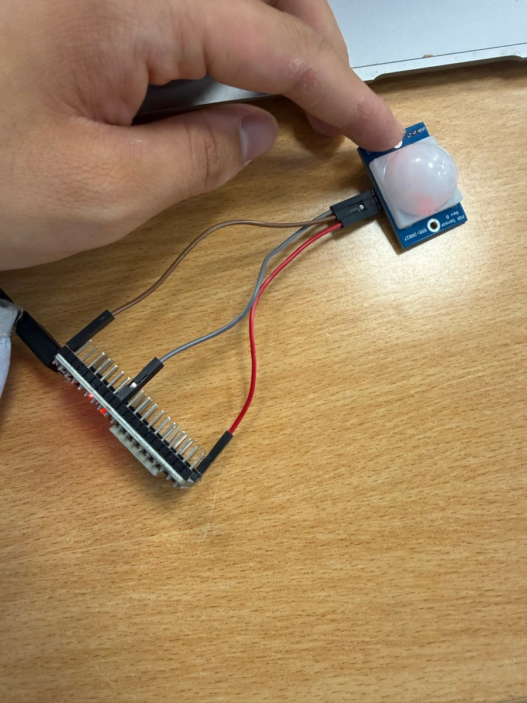

# ESP32 Monitor: "Your Phone Is Talking About You"

An ESP32 that counts the phones in a room **without connecting to anything**.

Phones with Wi-Fi turned on keep broadcasting *Probe Requests* in the background, asking "is any network I know nearby?". This firmware puts the ESP32 radio in promiscuous (monitor) mode, hops across Wi-Fi channels 1–13, and listens for those frames. Every 5 seconds it reports:

> **I count 23 devices in this room**

You can then compare that number with the **real head count** you type in, and with a **PIR motion sensor** on the same board.

It is a classroom and outreach demo of how much a phone gives away passively. It is also a small experiment in occupancy sensing: Wi-Fi counting vs. PIR vs. ground truth.



---

## What it shows

| Line on the serial monitor | Meaning |
|---|---|
| `MACs heard (any distance)` | Every device whose probe requests reached the ESP32 in the time window, including devices in the corridor or next room |
| `MACs in this room` | Only devices with RSSI ≥ the room threshold (default −70 dBm) |
| `I count N devices in this room` | Estimate after merging randomized MACs that share the same capability fingerprint |
| `PIR (GPIO27)` | `MOTION` / `idle`, seconds since the last motion, number of triggers |
| `Real head count` | The number you typed, devices per person, and the difference from the estimate |
| `nearest devices` | Strongest devices, with the middle of each MAC hidden (`3A:3C:xx:xx:xx:41`) |
| `network names phones are asking for` | SSIDs leaked by phones that probe for a specific saved network |

### How the estimate works

1. **Capture**: keep only management frames whose first byte is `0x40` (Probe Request), and read the transmitter MAC (addr2) and the RSSI.
2. **Room filter**: ignore devices weaker than the RSSI threshold, and forget devices not heard within the time window (default 60 s).
3. **Randomized vs. real MAC**: modern phones use *locally administered* random MACs (bit `0x02` of the first octet set) and rotate them, so one phone can show up as several MACs.
4. **Fingerprint**: for each probe, hash the Information Elements that describe the hardware and driver (supported rates, HT/VHT/HE capabilities, extended capabilities, vendor OUIs). Randomized MACs from the same phone usually share this hash, so they are counted once. Real MACs are counted one each.

`estimate = (distinct real MACs) + (distinct fingerprints among randomized MACs)`

The estimate is approximate:
- **Overcount**: one person carrying a phone, a watch and a laptop; devices behind walls.
- **Undercount**: phones that are locked and idle send very few probes; two phones of the same model can share a fingerprint and be merged.

The interesting part of the demo is comparing it with the real head count and the PIR.

---

## Hardware

| Part | Notes |
|---|---|
| ESP32 dev board (ESP32-D0WDQ6, CP2102 USB-UART) | Any classic ESP32 board works. Also builds for ESP32-S2 (see below) |
| PIR motion sensor | Tested with Parallax PIR Sensor Rev B (555-28027). HC-SR501 and similar modules also work |
| 3 jumper wires | |

### Wiring

| PIR pin | ESP32 pin |
|---|---|
| OUT | **GPIO27** (labelled `27`, `D27`, `P27` or `IO27`) |
| VCC | **VIN / 5V** |
| GND | **GND** |

> ⚠️ **Do not connect anything to `CLK`, `SD0`–`SD3` or `CMD` (GPIO 6–11).** They are wired to the board's flash chip. A wire there made flashing fail with `MD5 of file does not match data in flash!` and made the board boot-loop with `cmd len -1 / ets_main.c 371`. If you see either error, unplug the sensor and flash again.

Most PIR modules have no LED, so you can't tell from the board whether it is powered. Watch the `PIR` line on the serial monitor instead. Give it 30–60 s to warm up after power-on.

To use another pin, change `PIR_GPIO` in [`main/main.c`](main/main.c).

---

## Build and flash

Requires [ESP-IDF](https://docs.espressif.com/projects/esp-idf/) v6.x (tested with v6.1.1).

```bash
git clone https://github.com/mjc030225/ESP32-monitor-phone-wifi.git
cd ESP32-monitor-phone-wifi
. $IDF_PATH/export.sh          # or your ESP-IDF activate script
idf.py set-target esp32        # use esp32s2 for an ESP32-S2 board
idf.py -p <PORT> flash monitor # e.g. /dev/cu.usbserial-0001 on macOS
```

Exit the monitor with `Ctrl + ]`.

If flashing stops at `Connecting....`, hold the **BOOT** button until writing starts. If the port is busy, close any other serial monitor first.

### Serial commands

Type in `idf.py monitor`, then press Enter:

| Command | Effect |
|---|---|
| `18` | Set the real head count to 18 |
| `t-65` | Set the "in this room" RSSI threshold to −65 dBm |
| `w120` | Set the time window to 120 s |
| `c` | Clear all collected devices and counters |

---

## Example output

```
================ Your Phone Is Talking About You ================
 uptime 10s | window 60s | room filter RSSI >= -70 dBm | probes heard 21
 MACs heard (any distance)      : 5
 MACs in this room              : 3  (2 randomized, 1 real)
 >>> I count 2 devices in this room <<<   (fingerprint estimate)
 PIR (GPIO27)                   : idle, last motion 20s ago, 2 triggers
 Real head count                : (type a number + Enter)
 --- nearest devices ---
  3A:3C:xx:xx:xx:41   -65 dBm  randomized fp=6C1B7C6A  2 frames
  5A:85:xx:xx:xx:63   -67 dBm  randomized fp=6C1B7C6A  2 frames
  FC:77:xx:xx:xx:D8   -68 dBm  real       fp=36B68899  3 frames
  60:1D:xx:xx:xx:0E   -75 dBm  real       fp=F42F5751  12 frames
  58:CD:xx:xx:xx:F7   -84 dBm  real       fp=059742A2  2 frames
 --- network names phones are asking for ---
  "Example-Hotspot"
==================================================================
```

The two randomized MACs share fingerprint `6C1B7C6A` and are counted as one device: one phone using two random addresses.

---

## Demo tips

- Power the board at least a minute before you start so the PIR finishes warming up.
- Ask people to unlock their phones or open the Wi-Fi settings page. The count jumps, because active screens probe far more often.
- In a small room surrounded by others, raise the threshold (`t-60`) so neighbours are not counted.
- If the PIR stays in `MOTION` too long, turn its delay potentiometer down.

## Privacy and ethics

This project is for education and demonstration.

- **No storage or transmission**: the firmware only counts. Nothing is stored or sent anywhere, MACs are shown partially masked, and everything is lost on reset.
- **No tracking**: do not adapt it to log or follow specific people's MAC addresses or SSIDs. In many jurisdictions that is regulated as personal data.
- **Ask first**: if you collect data in a class or public space, tell the people present or get permission first.

---

## 中文简介

**"你的手机在暴露你"**：ESP32 不连接任何网络，只监听手机在后台广播的 Wi-Fi 探测帧（Probe Request），估算出"这个房间里有 N 台设备"。它可以和你输入的真实人数、PIR 人体感应器的结果放在一起对比。

- **原理**：ESP32 进入监听模式，在 1–13 信道之间轮流切换，按信号强度筛出本房间内的设备。随机化的 MAC 按设备能力指纹合并后再计数。
- **接线**：PIR 的 OUT 接 **GPIO27**，VCC 接 **VIN/5V**，GND 接 **GND**。**不要接 CLK、SD0–SD3、CMD（GPIO 6–11）**，接上会导致烧录失败或无限重启。
- **编译烧录**：`idf.py set-target esp32 && idf.py -p <串口> flash monitor`
- **串口命令**：输入数字设置真实人数，`t-65` 调信号阈值，`w120` 调时间窗口，`c` 清空。
- **用途**：隐私科普演示、房间占用和人流估算、多种传感器的对比实验。
- **注意**：仅用于教学演示。程序不保存也不上传任何数据，请勿用于追踪他人。

## License

MIT
